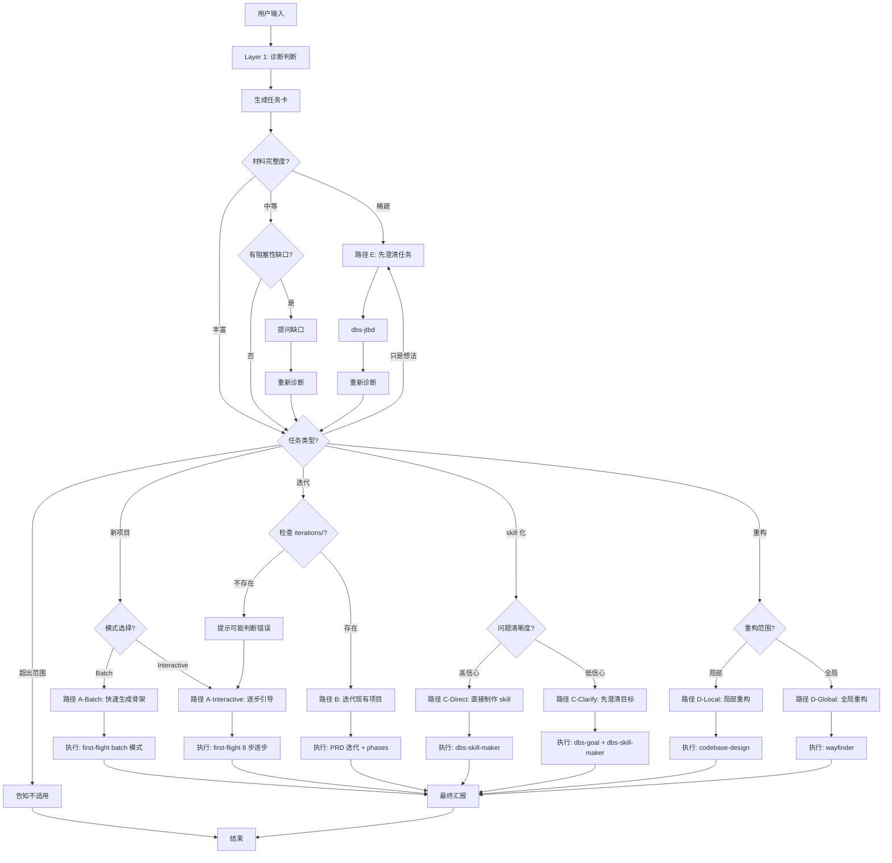

# 建站元技能 2.0 — 路由决策树

**设计时间**：2026-09-30  
**输入**：三层架构 + 问题契约与行为契约  
**目标**：设计完整的路由决策树，包含 5 种任务类型 × 5 条执行路径

---

## 1. 决策树概览



---

## 2. 决策节点详解

### 节点 1：材料完整度评估

**输入**：任务卡中的材料完整度字段

**判断依据**：
- **丰富**：可指物性 + 情境清晰 + 完成边界 都清楚
- **中等**：3 个维度中有 2 个清楚
- **稀疏**：3 个维度中只有 0-1 个清楚

**分支路径**：
```
稀疏 → 路径 E（先用 dbs-jtbd 澄清任务）
中等 → 检查是否有阻塞性缺口
  ├─ 有缺口 → 提问 → 重新诊断
  └─ 无缺口 → 进入节点 2
丰富 → 直接进入节点 2
```

**示例**：
```
输入 1："做个作品集"
  → 可指物性：✅ 作品集网站
  → 情境清晰：❓ 给谁看？
  → 完成边界：❓ 包含哪些内容？
  → 材料完整度：中等

输入 2："做点东西"
  → 可指物性：❌ 不知道做什么
  → 情境清晰：❌ 不知道场景
  → 完成边界：❌ 不知道边界
  → 材料完整度：稀疏
```

---

### 节点 2：任务类型判断

**输入**：任务卡中的任务类型字段

**判断依据**：
| 任务类型 | 关键词 | 目录状态 | LLM 判断 |
|---------|-------|---------|---------|
| **新项目** | "做个""搭个""想做" | 无 iterations/ | 创建性任务 |
| **迭代** | "加""改""更新" | 有 iterations/ | 增量性任务 |
| **skill 化** | "反复""每次""自动化" | - | 模式提取 |
| **重构** | "优化""重构""改架构" | 有代码 | 结构调整 |
| **只是想法** | "想法""不确定""点子" | - | 探索性 |

**优先级**：
1. 目录状态（最可靠）
2. 关键词匹配（次可靠）
3. LLM 综合判断（兜底）

**分支路径**：
```
新项目 → 节点 3-A（模式选择）
迭代 → 节点 3-B（检查 iterations/）
skill 化 → 节点 3-C（问题清晰度）
重构 → 节点 3-D（重构范围）
只是想法 → 路径 E（先澄清任务）
超出范围 → 告知不适用，结束
```

---

### 节点 3-A：新项目模式选择

**输入**：任务卡中的推荐模式字段

**判断依据**：
```
用户明说"一次性做完" → Batch
材料完整度 = 丰富 + 信心水平 = 高 → 建议 Batch（但默认 Interactive）
其他 → Interactive
```

**分支路径**：
```
Batch → 路径 A-Batch
  skill 序列：first-flight（batch 模式）
  特点：生成 6 份骨架 + TODO 标注，一次性交付

Interactive → 路径 A-Interactive
  skill 序列：first-flight-grill → brief → prd → design → architecture → content → agents → phases
  特点：每步可停，用户参与决策
```

**示例**：
```
输入："做个作品集网站，一次性生成所有文档"
  → 推荐模式：Batch
  → 路径：A-Batch

输入："帮我搭个产品官网"
  → 推荐模式：Interactive（默认）
  → 路径：A-Interactive
```

---

### 节点 3-B：迭代情境检查

**输入**：工作目录状态

**判断依据**：
```bash
# 检查 iterations/ 目录是否存在
if [ -d "iterations/" ]; then
  echo "存在"
else
  echo "不存在"
fi

# 检查 BRIEF.md 是否存在
if [ -f "BRIEF.md" ]; then
  echo "存在"
else
  echo "不存在"
fi
```

**分支路径**：
```
iterations/ 存在 + BRIEF.md 存在 → 路径 B（确认是迭代）
  skill 序列：first-flight-prd（迭代模式）→ first-flight-phases

iterations/ 不存在 → 提示"未检测到 iterations/，可能判断错了"
  → 询问用户"这是首次建站还是迭代？"
  → 用户确认首次 → 切换到路径 A-Interactive
  → 用户确认迭代 → 继续路径 B（但提示"建议先运行 first-flight 创建 BRIEF"）
```

**示例**：
```
输入："给我的网站加个博客功能"
  → 任务类型：迭代
  → 检查目录：iterations/ 存在
  → 路径：B

输入："改一下首页"
  → 任务类型：迭代
  → 检查目录：iterations/ 不存在
  → 提示：可能判断错了
  → 询问用户确认
```

---

### 节点 3-C：skill 化问题清晰度

**输入**：任务卡中的信心水平字段

**判断依据**：
```
信心水平 = 高 → 问题清楚
  特征：
  - 用户给出了反复案例
  - 能清楚描述输入输出
  - 能说出具体痛点

信心水平 = 中/低 → 问题模糊
  特征：
  - 只说"反复遇到"但没具体案例
  - 不确定要解决什么问题
  - 没说清输入输出
```

**分支路径**：
```
高信心 → 路径 C-Direct
  skill 序列：dbs-skill-maker
  特点：直接制作 skill

中/低信心 → 路径 C-Clarify
  skill 序列：dbs-goal → dbs-skill-maker
  特点：先澄清目标，再制作 skill
```

**示例**：
```
输入："每次写 API 文档都要写相同的字段说明（method/path/params/response），能自动化吗？我有 3 个案例"
  → 信心水平：高（有具体案例 + 清楚输入输出）
  → 路径：C-Direct

输入："反复遇到一些任务，想做成 skill"
  → 信心水平：低（没具体案例）
  → 路径：C-Clarify
```

---

### 节点 3-D：重构范围

**输入**：用户描述 + 代码库状态

**判断依据**：
```
局部重构：
  - 影响 1-3 个文件
  - 不改变整体架构
  - 关键词："这个函数""这个组件""局部"

全局重构：
  - 影响多个目录
  - 改变架构模式（如 Redux → Zustand）
  - 关键词："整个项目""架构""全局"
```

**分支路径**：
```
局部 → 路径 D-Local
  skill 序列：codebase-design（局部优化）

全局 → 路径 D-Global
  skill 序列：wayfinder（大型规划）
```

**示例**：
```
输入："把这个 UserProfile 组件拆成更小的组件"
  → 重构范围：局部
  → 路径：D-Local

输入："把整个状态管理从 Redux 改成 Zustand"
  → 重构范围：全局
  → 路径：D-Global
```

---

## 3. 五条执行路径详解

### 路径 A-Batch：快速生成骨架

**触发条件**：
- 任务类型 = 新项目
- 推荐模式 = Batch
- 材料完整度 = 丰富

**执行流程**：
```
1. 调用 first-flight（batch 模式）
   输入：用户描述
   输出：6 份文档骨架（BRIEF / PRD / DESIGN / ARCHITECTURE / CONTENT / AGENTS）
   
2. 标注 TODO
   在每份文档中标注需要用户补充的地方
   
3. 一次性汇报
   展示 6 份文档 + TODO 清单
   询问"要继续实施吗？"
```

**skill 调用伪代码**：
```javascript
await invokeSkill('first-flight', {
  mode: 'batch',
  input: userDescription,
  output: 'root directory'
});

// first-flight 内部会：
// 1. 生成 BRIEF.md（长期纲领 + TODO）
// 2. 生成 PRD.md（首版功能 + TODO）
// 3. 生成 DESIGN.md（视觉风格 + TODO）
// 4. 生成 ARCHITECTURE.md（技术选型 + TODO）
// 5. 生成 CONTENT.md（内容填充 + TODO）
// 6. 生成 AGENTS.md（AI 入口 + TODO）

reportBatch({
  files: [
    'BRIEF.md',
    'PRD.md',
    'DESIGN.md',
    'ARCHITECTURE.md',
    'CONTENT.md',
    'AGENTS.md'
  ],
  todos: extractTodos()
});
```

**优势**：
- 快速：一次生成全部文档
- 完整：覆盖全部规划维度
- 灵活：用户可以自行补充 TODO

**劣势**：
- 质量：骨架可能不够细致
- 参与：用户无法在过程中干预

---

### 路径 A-Interactive：逐步引导

**触发条件**：
- 任务类型 = 新项目
- 推荐模式 = Interactive（默认）

**执行流程**：
```
1. first-flight-grill（问题定义）
   输入：用户描述
   输出：GRILL.md（5 个问题 + 答案）
   汇报："问题定义完成，要继续吗？"
   
2. first-flight-brief（长期纲领）
   输入：GRILL.md
   输出：BRIEF.md
   汇报："长期纲领完成，要继续吗？"
   
3. first-flight-prd（首版 PRD）
   输入：BRIEF.md
   输出：PRD.md
   汇报："PRD 完成，要继续吗？"
   
4. first-flight-design（视觉风格）
   输入：BRIEF.md + PRD.md
   输出：DESIGN.md
   汇报："设计风格完成，要继续吗？"
   
5. first-flight-architecture（技术选型）
   输入：BRIEF.md + PRD.md
   输出：ARCHITECTURE.md
   汇报："技术架构完成，要继续吗？"
   
6. first-flight-content（内容填充）
   输入：所有前序文档
   输出：CONTENT.md
   汇报："内容规划完成，要继续吗？"
   
7. first-flight-agents（AI 入口）
   输入：所有前序文档
   输出：AGENTS.md
   汇报："AI 配置完成，要继续吗？"
   
8. first-flight-phases（分阶段实施）
   输入：所有文档
   输出：执行报告
   汇报："实施完成 🎉"
```

**skill 调用伪代码**：
```javascript
const skills = [
  'first-flight-grill',
  'first-flight-brief',
  'first-flight-prd',
  'first-flight-design',
  'first-flight-architecture',
  'first-flight-content',
  'first-flight-agents',
  'first-flight-phases'
];

for (const skill of skills) {
  const result = await invokeSkill(skill);
  
  report({
    skill: skill,
    output: result.files,
    keyPoints: result.summary
  });
  
  const userResponse = await ask("要继续吗？");
  
  if (userResponse === '停止') {
    break;
  }
}
```

**优势**：
- 质量：每步都充分思考
- 参与：用户可以随时调整方向
- 灵活：可以中途停止

**劣势**：
- 慢：需要多次确认
- 打断：用户需要持续参与

---

### 路径 B：迭代现有项目

**触发条件**：
- 任务类型 = 迭代
- iterations/ 目录存在
- BRIEF.md 存在

**执行流程**：
```
1. 检测已有文件
   读取：BRIEF.md（长期纲领）
   读取：最新版 PRD.md（从 iterations/ 中找）
   
2. first-flight-prd（迭代模式）
   输入：
     - BRIEF.md（长期约束）
     - 上一版 PRD.md（已有功能）
     - 用户新需求
   输出：
     - iterations/v{N}-{slug}/PRD.md（新版 PRD）
   汇报："PRD 完成，要继续吗？"
   
3. first-flight-phases（实施迭代）
   输入：新版 PRD.md
   输出：执行报告
   汇报："迭代完成 🎉"
```

**版本号规则**：
```javascript
// 读取 iterations/ 目录
const versions = fs.readdirSync('iterations/')
  .filter(f => f.startsWith('v'))
  .map(f => parseInt(f.match(/v(\d+)/)[1]));

const latestVersion = Math.max(...versions);
const nextVersion = latestVersion + 1;

// 生成新版本目录
const slug = generateSlug(userFeature); // 如 "blog"
const newDir = `iterations/v${nextVersion}-${slug}`;
```

**skill 调用伪代码**：
```javascript
// Step 1: 读取已有文件
const brief = await readFile('BRIEF.md');
const latestPRD = await findLatestPRD('iterations/');

// Step 2: 生成新版 PRD
const newPRD = await invokeSkill('first-flight-prd', {
  mode: 'iteration',
  brief: brief,
  previousPRD: latestPRD,
  newRequirement: userInput
});

report({
  skill: 'first-flight-prd',
  output: newPRD.path,
  version: newPRD.version,
  changes: newPRD.diff
});

const userResponse = await ask("要继续实施吗？");

if (userResponse === '是') {
  // Step 3: 实施迭代
  await invokeSkill('first-flight-phases', {
    prd: newPRD.path
  });
}
```

**优势**：
- 延续性：尊重 BRIEF 的长期约束
- 可追溯：版本化管理
- 增量：只关注新需求

**劣势**：
- 依赖：必须有 BRIEF 和 iterations/
- 复杂：版本管理增加复杂度

---

### 路径 C-Direct：直接制作 skill

**触发条件**：
- 任务类型 = skill 化
- 信心水平 = 高
- 有反复案例

**执行流程**：
```
1. dbs-skill-maker
   输入：
     - 问题描述
     - 反复案例（至少 2 个）
   输出：
     - ~/.agents/skills/{skill-name}/SKILL.md
     - 验证等级（L1-L3）
   汇报：
     - skill 文件路径
     - 验证等级
     - 使用方法
```

**skill 调用伪代码**：
```javascript
const result = await invokeSkill('dbs-skill-maker', {
  problem: userProblem,
  examples: userExamples
});

report({
  skill: 'dbs-skill-maker',
  output: result.skillPath,
  verificationLevel: result.level, // L1 / L2 / L3
  usage: result.howToUse
});
```

**验证等级说明**：
- **L1（推理验证）**：内部自洽，无明显逻辑错误
- **L2（案例验证）**：通过用户提供的案例测试
- **L3（实战验证）**：在真实场景中使用并确认有效

**优势**：
- 快速：跳过澄清步骤
- 直接：立即生成 skill

**劣势**：
- 风险：如果问题理解错了，生成的 skill 不可用

---

### 路径 C-Clarify：先澄清目标再制作

**触发条件**：
- 任务类型 = skill 化
- 信心水平 = 中/低
- 没有明确案例

**执行流程**：
```
1. dbs-goal（目标澄清）
   输入：用户模糊描述
   输出：目标卡（goal_card.md）
   汇报："目标澄清完成，要继续制作 skill 吗？"
   
2. dbs-skill-maker
   输入：目标卡
   输出：SKILL.md + 验证等级
   汇报："skill 制作完成 🎉"
```

**skill 调用伪代码**：
```javascript
// Step 1: 澄清目标
const goalCard = await invokeSkill('dbs-goal', {
  userInput: userDescription
});

report({
  skill: 'dbs-goal',
  output: goalCard.path,
  maturityScore: goalCard.score // 5 维度评分
});

const userResponse = await ask("目标清楚了吗？要继续制作 skill 吗？");

if (userResponse === '是') {
  // Step 2: 制作 skill
  const skill = await invokeSkill('dbs-skill-maker', {
    goalCard: goalCard.content
  });
  
  report({
    skill: 'dbs-skill-maker',
    output: skill.path,
    verificationLevel: skill.level
  });
}
```

**优势**：
- 准确：先搞清楚要做什么
- 质量：生成的 skill 更可靠

**劣势**：
- 慢：多一个澄清步骤

---

### 路径 D-Local：局部重构

**触发条件**：
- 任务类型 = 重构
- 重构范围 = 局部

**执行流程**：
```
1. codebase-design（局部优化）
   输入：
     - 目标代码位置
     - 重构目标
   输出：
     - 重构计划
     - 修改后的代码
   汇报："重构完成 🎉"
```

**skill 调用伪代码**：
```javascript
const result = await invokeSkill('codebase-design', {
  target: userTarget, // 如 "src/components/UserProfile.tsx"
  goal: userGoal      // 如 "拆成更小的组件"
});

report({
  skill: 'codebase-design',
  changedFiles: result.files,
  plan: result.plan
});
```

---

### 路径 D-Global：全局重构

**触发条件**：
- 任务类型 = 重构
- 重构范围 = 全局

**执行流程**：
```
1. wayfinder（大型规划）
   输入：
     - 当前代码库状态
     - 重构目标
   输出：
     - 分阶段重构计划
     - 风险评估
   汇报："规划完成，要开始执行吗？"
   
2. 执行重构计划
   （可能需要人工参与，不一定全自动）
```

**skill 调用伪代码**：
```javascript
const plan = await invokeSkill('wayfinder', {
  codebase: '.',
  goal: userGoal // 如 "从 Redux 迁移到 Zustand"
});

report({
  skill: 'wayfinder',
  plan: plan.phases,
  risks: plan.risks,
  estimatedTime: plan.estimate
});

const userResponse = await ask("要开始执行吗？");

if (userResponse === '是') {
  // 执行重构（可能需要多步）
  for (const phase of plan.phases) {
    await executePhase(phase);
  }
}
```

---

### 路径 E：先澄清任务

**触发条件**：
- 任务类型 = 只是想法
- 或材料完整度 = 稀疏

**执行流程**：
```
1. dbs-jtbd（任务澄清）
   输入：用户模糊描述
   输出：任务陈述（JTBD 格式）
   汇报："任务澄清完成，现在我们重新看看要做什么"
   
2. 重新诊断
   输入：任务陈述（作为新的用户输入）
   输出：新任务卡
   
3. 重新路由
   根据新任务卡选择路径（回到节点 2）
```

**skill 调用伪代码**：
```javascript
// Step 1: 澄清任务
const jtbd = await invokeSkill('dbs-jtbd', {
  userInput: userDescription
});

report({
  skill: 'dbs-jtbd',
  output: jtbd.statement // "当用户想 XXX 时，需要 YYY，以便 ZZZ"
});

// Step 2: 重新诊断
const newTaskCard = await diagnose({
  input: jtbd.statement,
  context: conversationHistory
});

report({
  message: "现在任务清楚了，我们重新规划路径"
});

// Step 3: 重新路由
const newPath = await route(newTaskCard);

// 继续执行新路径
await executePath(newPath);
```

**优势**：
- 适应：能处理极度模糊的输入
- 转化：把想法转化为可执行任务

**劣势**：
- 绕路：增加一个步骤
- 依赖：需要 dbs-jtbd skill

---

## 4. 条件分支处理

### 分支 1：补齐阻塞性缺口后路径变化

**场景**：
```
初始诊断：
  任务类型：新项目
  材料完整度：中等
  阻塞性缺口：["目标受众是谁？"]
  
提问缺口：
  用户回答："给潜在雇主看"
  
重新诊断：
  任务类型：新项目（不变）
  材料完整度：丰富（提升）
  推荐模式：可以 Batch
  
路径变化：
  原本：A-Interactive
  现在：询问用户"材料已经很完整了，要用 Batch 模式一次性生成吗？"
```

**实现伪代码**：
```javascript
// 初始诊断
let taskCard = await diagnose(userInput);

// 如果有缺口
if (taskCard.材料完整度 === '中等' && taskCard.阻塞性缺口.length > 0) {
  // 提问
  for (const gap of taskCard.阻塞性缺口) {
    const answer = await ask(gap.问题);
    // 记录答案到上下文
    context.push({ question: gap.问题, answer: answer });
  }
  
  // 重新诊断
  taskCard = await diagnose({
    input: userInput,
    context: context
  });
  
  // 检查路径是否变化
  if (taskCard.材料完整度 === '丰富' && taskCard.推荐模式 === 'Batch') {
    await ask("材料已经很完整了，要用 Batch 模式一次性生成吗？");
  }
}
```

---

### 分支 2：中途发现任务类型判断错误

**场景**：
```
初始诊断：
  任务类型：新项目
  路径：A-Interactive
  
执行中：
  first-flight 检测到 iterations/ 目录存在
  
处理：
  提示："检测到 iterations/ 目录，这可能是迭代任务而不是新项目"
  询问："这是首次建站还是迭代？"
  
用户回答"迭代"：
  切换到路径 B
  从 first-flight-prd（迭代模式）开始
```

**实现伪代码**：
```javascript
// 在 first-flight 执行前检查
if (taskCard.任务类型 === '新项目') {
  const hasIterations = fs.existsSync('iterations/');
  
  if (hasIterations) {
    const confirm = await ask(
      "检测到 iterations/ 目录，这可能是迭代任务。\n" +
      "这是首次建站还是迭代？\n" +
      "1. 首次建站（继续新项目流程）\n" +
      "2. 迭代（切换到迭代流程）"
    );
    
    if (confirm === '2') {
      // 切换路径
      taskCard.任务类型 = '迭代';
      const newPath = await route(taskCard);
      await executePath(newPath);
      return; // 不继续执行新项目流程
    }
  }
}

// 继续执行新项目流程
await invokeSkill('first-flight', ...);
```

---

### 分支 3：Skill 不存在时的降级处理

**场景**：
```
路径选择：C-Direct（直接制作 skill）
skill 调用：dbs-skill-maker
  
错误：dbs-skill-maker 未安装
  
处理：
  提示："dbs-skill-maker 未安装"
  选项：
    1. 安装它（给出命令）
    2. 用对话模式手动制作 skill
    3. 放弃
```

**实现伪代码**：
```javascript
async function invokeSkill(skillName, options) {
  const skillPath = `~/.agents/skills/${skillName}/SKILL.md`;
  
  if (!fs.existsSync(skillPath)) {
    const choice = await ask(
      `❌ ${skillName} 未安装\n\n` +
      `选择处理方式：\n` +
      `1. 安装它（我会给出命令）\n` +
      `2. 用对话模式手动完成\n` +
      `3. 停止任务\n\n` +
      `你的选择？`
    );
    
    switch (choice) {
      case '1':
        report({
          message: `安装命令：\n\`\`\`bash\n# 从哪里获取这个 skill？\n\`\`\``
        });
        throw new Error('需要安装 skill');
      
      case '2':
        report({
          message: `好的，我们用对话模式完成。请告诉我具体需求。`
        });
        // 降级到对话模式
        return await manualMode(options);
      
      case '3':
        throw new Error('用户停止任务');
    }
  }
  
  // skill 存在，正常调用
  return await callSkill(skillName, options);
}
```

---

## 5. 路由决策树实现

### 实现方式 1：if-else 树

```javascript
function selectPath(taskCard) {
  // 节点 1：材料完整度
  if (taskCard.材料完整度 === '稀疏') {
    return PATH_E;
  }
  
  if (taskCard.材料完整度 === '中等' && taskCard.阻塞性缺口.length > 0) {
    return {
      action: 'ASK_GAPS',
      gaps: taskCard.阻塞性缺口,
      then: 'RE_DIAGNOSE'
    };
  }
  
  // 节点 2：任务类型
  switch (taskCard.任务类型) {
    case '新项目':
      // 节点 3-A
      if (taskCard.推荐模式 === 'Batch') {
        return PATH_A_BATCH;
      } else {
        return PATH_A_INTERACTIVE;
      }
    
    case '迭代':
      // 节点 3-B
      if (detectIterationsDir()) {
        return PATH_B;
      } else {
        return {
          action: 'WARN',
          message: '未检测到 iterations/，可能判断错误',
          confirm: '这是首次建站还是迭代？',
          then: {
            '首次': PATH_A_INTERACTIVE,
            '迭代': PATH_B
          }
        };
      }
    
    case 'skill 化':
      // 节点 3-C
      if (taskCard.信心水平 === '高') {
        return PATH_C_DIRECT;
      } else {
        return PATH_C_CLARIFY;
      }
    
    case '重构':
      // 节点 3-D
      if (taskCard.重构范围 === '局部') {
        return PATH_D_LOCAL;
      } else {
        return PATH_D_GLOBAL;
      }
    
    case '只是想法':
      return PATH_E;
    
    default:
      return {
        action: 'REJECT',
        message: '此任务超出 meta-builder 覆盖范围'
      };
  }
}
```

### 实现方式 2：配置驱动

```javascript
const ROUTING_RULES = [
  {
    condition: (card) => card.材料完整度 === '稀疏',
    path: PATH_E,
    reason: '材料稀疏，需要先澄清任务'
  },
  {
    condition: (card) => card.材料完整度 === '中等' && card.阻塞性缺口.length > 0,
    action: 'ASK_GAPS',
    reason: '有阻塞性缺口，需要先提问'
  },
  {
    condition: (card) => card.任务类型 === '新项目' && card.推荐模式 === 'Batch',
    path: PATH_A_BATCH,
    reason: '新项目 + Batch 模式'
  },
  {
    condition: (card) => card.任务类型 === '新项目',
    path: PATH_A_INTERACTIVE,
    reason: '新项目 + Interactive 模式（默认）'
  },
  {
    condition: (card) => card.任务类型 === '迭代' && detectIterationsDir(),
    path: PATH_B,
    reason: '迭代 + 有 iterations/ 目录'
  },
  // ... 更多规则
];

function selectPath(taskCard) {
  for (const rule of ROUTING_RULES) {
    if (rule.condition(taskCard)) {
      return {
        path: rule.path,
        action: rule.action,
        reason: rule.reason
      };
    }
  }
  
  // 默认：告知不适用
  return {
    action: 'REJECT',
    message: '未匹配到任何路径'
  };
}
```

**推荐**：方式 2（配置驱动）
- 更易维护
- 可以动态添加规则
- 便于测试

---

## 6. 路由层测试用例

### 测试样本 1：新项目（丰富材料）

**输入**：
```
用户消息："做个人作品集网站，展示我的设计作品。目标受众是潜在雇主。包含首页、作品列表、作品详情、关于我。"

任务卡：
  任务类型：新项目
  材料完整度：丰富
  推荐模式：Interactive（默认）
```

**期望路径**：PATH_A_INTERACTIVE

**路由决策**：
```
节点 1：材料完整度 = 丰富 → 进入节点 2
节点 2：任务类型 = 新项目 → 进入节点 3-A
节点 3-A：推荐模式 = Interactive → 路径 A-Interactive
```

**执行计划**：
```markdown
## 执行计划

**路径**：A-Interactive（逐步引导）

**skill 序列**：
1. first-flight-grill（问题定义）
2. first-flight-brief（长期纲领）
3. first-flight-prd（首版 PRD）
4. first-flight-design（视觉风格）
5. first-flight-architecture（技术选型）
6. first-flight-content（内容填充）
7. first-flight-agents（AI 入口）
8. first-flight-phases（分阶段实施）

**预计耗时**：30-60 分钟
```

---

### 测试样本 2：迭代（有 iterations/）

**输入**：
```
用户消息："给我的网站加个博客功能"

工作目录：
  - BRIEF.md（存在）
  - iterations/v1-initial/（存在）

任务卡：
  任务类型：迭代
  材料完整度：中等
```

**期望路径**：PATH_B

**路由决策**：
```
节点 1：材料完整度 = 中等 + 无阻塞性缺口 → 进入节点 2
节点 2：任务类型 = 迭代 → 进入节点 3-B
节点 3-B：检测到 iterations/ 存在 → 路径 B
```

**执行计划**：
```markdown
## 执行计划

**路径**：B（迭代现有项目）

**skill 序列**：
1. first-flight-prd（迭代模式，版本 v2-blog）
2. first-flight-phases（实施迭代）

**预计耗时**：15-30 分钟
```

---

### 测试样本 3：skill 化（问题清楚）

**输入**：
```
用户消息："每次写 API 文档都要写相同的字段（method, path, params, response），能自动化吗？我有 3 个案例：GET /users, POST /users, GET /users/:id"

任务卡：
  任务类型：skill 化
  信心水平：高（有具体案例）
```

**期望路径**：PATH_C_DIRECT

**路由决策**：
```
节点 1：材料完整度 = 丰富 → 进入节点 2
节点 2：任务类型 = skill 化 → 进入节点 3-C
节点 3-C：信心水平 = 高 → 路径 C-Direct
```

**执行计划**：
```markdown
## 执行计划

**路径**：C-Direct（直接制作 skill）

**skill 序列**：
1. dbs-skill-maker

**预计耗时**：10-20 分钟
```

---

### 测试样本 4：重构（全局）

**输入**：
```
用户消息："把整个项目的状态管理从 Redux 改成 Zustand"

工作目录：
  - src/store/（存在，使用 Redux）

任务卡：
  任务类型：重构
  重构范围：全局
```

**期望路径**：PATH_D_GLOBAL

**路由决策**：
```
节点 1：材料完整度 = 丰富 → 进入节点 2
节点 2：任务类型 = 重构 → 进入节点 3-D
节点 3-D：重构范围 = 全局 → 路径 D-Global
```

**执行计划**：
```markdown
## 执行计划

**路径**：D-Global（全局重构）

**skill 序列**：
1. wayfinder（大型规划）

**预计耗时**：根据代码库规模，30-120 分钟
```

---

### 测试样本 5：只是想法 → 澄清后重新路由

**输入**：
```
用户消息："有个想法，不确定怎么开始"

任务卡：
  任务类型：只是想法
  材料完整度：稀疏
```

**期望路径**：PATH_E → 重新诊断 → 新路径

**路由决策（第一次）**：
```
节点 1：材料完整度 = 稀疏 → 路径 E
```

**执行流程**：
```
1. dbs-jtbd 澄清任务
   用户补充："想做个工具帮我管理每天的学习笔记"
   输出：任务陈述

2. 重新诊断
   任务类型：新项目（做工具）
   材料完整度：中等

3. 重新路由
   节点 2：任务类型 = 新项目 → 路径 A-Interactive
```

**最终执行计划**：
```markdown
## 执行计划（重新规划后）

**路径**：A-Interactive（逐步引导）

**skill 序列**：
1. first-flight-grill
2. first-flight-brief
3. ...
```

---

### 测试样本 6：超出范围（拒绝）

**输入**：
```
用户消息："帮我写一篇关于 AI 的文章"

任务卡：
  任务类型：内容创作（不在 5 种类型内）
```

**期望行为**：告知不适用

**路由决策**：
```
节点 2：任务类型 = 内容创作 → 超出范围
```

**输出**：
```markdown
❌ 此任务超出 meta-builder 覆盖范围

meta-builder 适用于：
- 新建网站/工具项目
- 迭代现有项目
- 将反复任务 skill 化
- 代码重构

你的任务「写文章」属于内容创作，建议直接用对话完成。

需要其他帮助吗？
```

---

## 7. 路由层性能优化

### 优化 1：缓存诊断结果

```javascript
// 避免重复诊断
const diagnosisCache = new Map();

async function diagnose(input) {
  const cacheKey = hash(input);
  
  if (diagnosisCache.has(cacheKey)) {
    return diagnosisCache.get(cacheKey);
  }
  
  const result = await runDiagnosis(input);
  diagnosisCache.set(cacheKey, result);
  
  return result;
}
```

### 优化 2：并行检测目录状态

```javascript
// 并行检查多个目录/文件
const [hasIterations, hasBrief, hasCode] = await Promise.all([
  fs.exists('iterations/'),
  fs.exists('BRIEF.md'),
  fs.exists('src/')
]);
```

### 优化 3：提前终止

```javascript
// 一旦匹配到路径，立即返回
for (const rule of ROUTING_RULES) {
  if (rule.condition(taskCard)) {
    return rule.path; // 不继续检查后续规则
  }
}
```

---

**下一步**：实现核心 skill（阶段 2）
